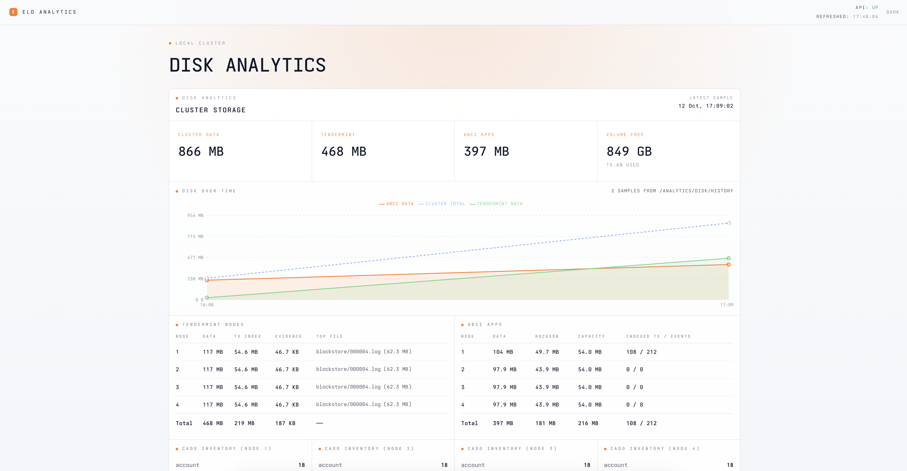

# Eld Analytics


[](LICENSE)
[](https://github.com/eldnetwork/eld-analytics/actions/workflows/ci.yml)

Eld Analytics is a **local-only** disk analytics dashboard for Eld clusters, built with [Vite](https://vitejs.dev/) and React. Run it on your machine against a local analytics API — it is not a hosted or deployable public site.



## Disclaimer

This repository is the **analytics dashboard frontend only** — not the Eld protocol, consensus node, analytics API, indexer, SDKs, or a wallet.

- It reads a local analytics HTTP API via a Vite proxy; it does not custody keys or submit transactions.
- Displayed disk data depends on that backend and may be incomplete, delayed, or wrong.
- For protocol docs and the marketing site, see [Documentation](https://docs.eld.network) and [eld.network](https://www.eld.network).
- The public block explorer UI lives in [eld-blockchain-explorer](https://github.com/eldnetwork/eld-blockchain-explorer).

## Architecture

```text
Browser (React SPA, localhost)
  └─ App → DiskWidget
       ├─ api/         HTTP helpers for /api (proxied)
       ├─ components/  disk chart + breakdown tables
       └─ lib/         formatting + history series builders
              │
              └─ Vite /api proxy → ANALYTICS_API_URL (default http://127.0.0.1:9010)
```

| Layer             | Role                                            |
| ----------------- | ----------------------------------------------- |
| `src/App.tsx`     | Shell, theme toggle, refresh loop               |
| `src/components/` | Disk growth chart and latest breakdown tables   |
| `src/api/`        | Typed fetch helpers for health + disk endpoints |
| `src/lib/`        | Byte/time formatting and history series helpers |
| `vite.config.ts`  | Dev server + `/api` proxy to the analytics API  |

## Prerequisites

- [Node.js](https://nodejs.org/) >= 20 (pinned in [`.nvmrc`](.nvmrc))
- A running Eld analytics API (default `http://127.0.0.1:9010`)

## Local development

```bash
npm install
cp .env.example .env
npm start
```

Dev server: [http://localhost:5173](http://localhost:5173). Vite proxies `/api/*` to `ANALYTICS_API_URL`.

### Environment variables

| Variable            | Required | Description                                                                   |
| ------------------- | -------- | ----------------------------------------------------------------------------- |
| `ANALYTICS_API_URL` | no       | Analytics API base URL for the `/api` proxy (default `http://127.0.0.1:9010`) |

### API endpoints used

| Method | Path                               | Description          |
| ------ | ---------------------------------- | -------------------- |
| `GET`  | `/health`                          | API health check     |
| `GET`  | `/analytics/disk/latest`           | Latest disk snapshot |
| `GET`  | `/analytics/disk/history?limit=48` | Recent disk history  |

The main widget shows disk growth over time plus the latest Tendermint / ABCI breakdown. It refreshes every 30 seconds.

## Scripts

| Script                      | Description                                                                           |
| --------------------------- | ------------------------------------------------------------------------------------- |
| `npm start` / `npm run dev` | Vite dev server                                                                       |
| `npm run build`             | Typecheck + production build → `dist/`                                                |
| `npm run preview`           | Serve the production build locally                                                    |
| `npm test`                  | Vitest (single run)                                                                   |
| `npm run test:watch`        | Vitest watch mode                                                                     |
| `npm run lint`              | oxlint                                                                                |
| `npm run format`            | Prettier write                                                                        |
| `npm run format:check`      | Prettier check                                                                        |
| `npm run ci`                | `format:check` → `lint` → tests → `npm audit --omit=dev --audit-level=high` → `build` |

```bash
npm run ci
```

## Links

- [Documentation](https://docs.eld.network)
- [Marketing site](https://www.eld.network)
- [Eld Blockchain Explorer](https://github.com/eldnetwork/eld-blockchain-explorer)
- [X / Twitter](https://x.com/eld_network)

## License

MIT — see [LICENSE](LICENSE).

Font files in `src/fonts/` are [Ioskeley Mono](https://github.com/ahatem/IoskeleyMono), licensed under the SIL Open Font License 1.1 — see [src/fonts/LICENSE](src/fonts/LICENSE).
